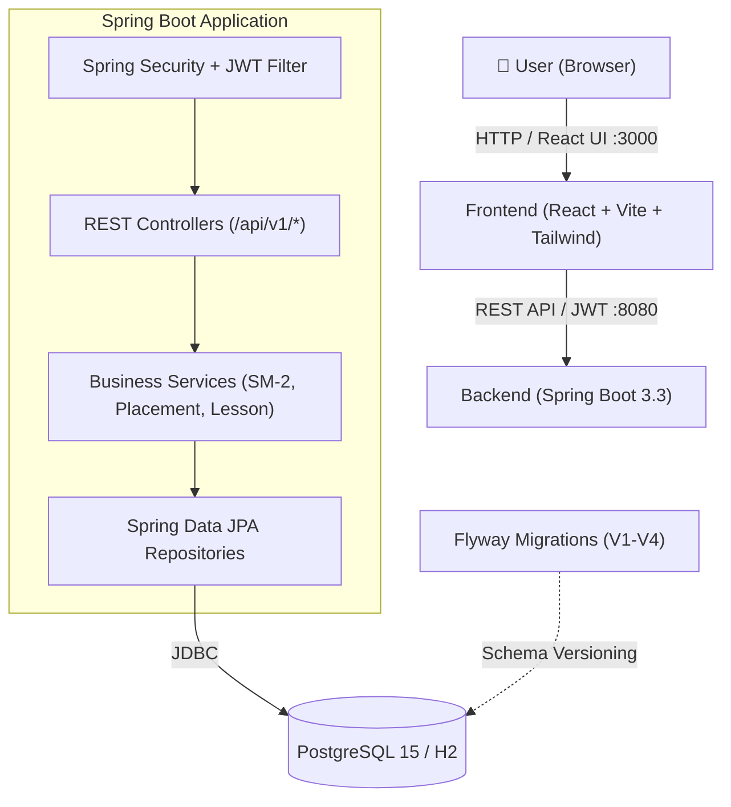

<p align="center">
  
</p>

<p align="center">
  <a href="README.md">Русский</a> | <a href="README.en.md">English</a>
</p>

<p align="center">
  
  
  
  
  
  
  
  
</p>

---

# Lingoreva (LingoPath) 🎓

**Lingoreva** is a modern, commercial-grade English learning web application designed with personalized learning paths, interactive practice modules, CEFR-aligned placement testing, and spaced repetition vocabulary review.

---

## 📑 Table of Contents

- [Key Features](#-key-features)
- [Tech Stack](#-tech-stack)
- [Architecture](#-architecture)
- [Project Structure](#-project-structure)
- [Quick Start](#-quick-start)
  - [Docker Compose (Recommended)](#1-run-with-docker-compose-recommended)
  - [Local Development Setup](#2-local-development-setup)
- [Environment Variables](#-environment-variables)
- [API Reference](#-api-reference)
- [Testing](#-testing)
- [Roadmap](#-roadmap)

---

## ✨ Key Features

- 🎯 **Adaptive CEFR Placement Test**
  - Evaluates grammar and vocabulary knowledge across levels from `Pre-A1` to `C2`.
  - Automatically assesses answers and assigns a personalized starting level.

- 🧭 **Personalized Onboarding & Study Trajectories**
  - Customizable goals: *Everyday communication, Travel English, Work English, IT & Programming, Business English, Interview prep, Academic English, Exam preparation*.
  - Skill focus selection: *Vocabulary, Grammar, Reading, Listening, Writing, Speaking, Pronunciation*.
  - Configurable daily practice targets (10, 20, 30+ minutes) and course duration.

- 📖 **Daily Lessons & Interactive Practice Lab**
  - Bite-sized structured theory, interactive tests with immediate validation and in-depth explanations.
  - Progression unlocked day-by-day based on completed milestones.

- 🧠 **Spaced Repetition Vocabulary (SM-2)**
  - Smart flashcard review system.
  - Interval scheduling calculated from user performance.
  - Contextual examples, definitions, and phonetics.

- 🔥 **Gamification & Analytics**
  - Experience points (XP), daily streaks, and completion analytics on a central dashboard.

- 🔐 **Secure Authentication**
  - Stateless JWT-based authentication.
  - Password hashing with BCrypt.
  - Comprehensive password strength validation on both client and server.

---

## 🛠 Tech Stack

### Backend
- **Language**: Java 21
- **Framework**: Spring Boot 3.3.4 (Spring Web, Spring Security, Spring Data JPA, Spring Validation)
- **Database**: PostgreSQL 15 (production / docker), H2 Database (tests and embedded fallback)
- **Database Migrations**: Flyway
- **Authentication**: JJWT 0.12.6
- **Build Tool**: Maven

### Frontend
- **Framework**: React 18
- **Language**: TypeScript 5
- **Bundler**: Vite 5
- **Styling**: Tailwind CSS 3.4, PostCSS, Autoprefixer
- **Icons**: Lucide React
- **HTTP Client**: Axios (with JWT interceptors)
- **Routing**: React Router DOM v6
- **Testing**: Vitest, React Testing Library, Jest DOM

### DevOps & Infrastructure
- Docker & Docker Compose
- Multi-stage Dockerfiles for backend and frontend

---

## 🏛 Architecture



---

## 📂 Project Structure

```text
LingoPath/
├── icon.jpeg                      # App logo icon
├── long.jpeg                      # Wide banner
├── tab icon.jpeg                  # Browser tab icon / favicon
├── README.md                      # Russian documentation
├── README.en.md                   # English documentation
└── lingoreva/
    ├── docker-compose.yml         # Full-stack Docker orchestration
    ├── backend/                   # Spring Boot backend
    │   ├── Dockerfile
    │   ├── pom.xml                # Maven configuration
    │   └── src/
    │       ├── main/
    │       │   ├── java/com/lingoreva/
    │       │   │   ├── config/    # Security, CORS, Exception Handler
    │       │   │   ├── controller/# REST Controllers
    │       │   │   ├── dto/       # Request & Response DTOs
    │       │   │   ├── entity/    # JPA Entities (User, Profile, Word, Lesson...)
    │       │   │   ├── repository/# JPA Repositories
    │       │   │   ├── security/  # JwtUtil, JwtFilter, CustomUserDetails
    │       │   │   └── service/   # Business Logic
    │       │   └── resources/
    │       │       ├── application.yml
    │       │       └── db/migration/ # Flyway SQL migrations (V1..V4)
    │       └── test/              # Integration and unit tests
    └── frontend/                  # React frontend
        ├── Dockerfile
        ├── package.json           # Node.js dependencies & scripts
        ├── vite.config.ts         # Vite build configuration & API proxy
        ├── tailwind.config.js     # Tailwind configuration
        └── src/
            ├── context/           # React Context (AuthContext)
            ├── data/              # Learning data, questions, and generators
            ├── pages/             # App pages (Dashboard, DailyLesson, PlacementTest...)
            ├── services/          # Axios instance & interceptors
            └── test/              # Component & integration tests
```

---

## 🚀 Quick Start

### 1. Run with Docker Compose (Recommended)

Ensure you have [Docker](https://www.docker.com/) and Docker Compose installed.

```bash
cd lingoreva
docker-compose up --build -d
```

Services will be available at:
- 🌐 **Frontend**: [http://localhost:3000](http://localhost:3000)
- ⚙️ **Backend API**: [http://localhost:8080](http://localhost:8080)
- 🗄️ **PostgreSQL**: `localhost:5432` (`postgres` / `postgres`)

---

### 2. Local Development Setup

#### Prerequisites:
- **JDK 21**
- **Node.js 18+** & **npm**
- **Maven 3.9+**

#### Step 1: Start Database (Optional)
```bash
cd lingoreva
docker-compose up -d postgres
```
*(By default, the backend falls back to an embedded H2 file database at `./data/lingoreva_db` if Postgres is not configured).*

#### Step 2: Run Backend
```bash
cd lingoreva/backend
mvn spring-boot:run
```
The server will start on port `8080`.

#### Step 3: Run Frontend
In a new terminal window:
```bash
cd lingoreva/frontend
npm install
npm run dev
```
The web app will open at [http://localhost:3000](http://localhost:3000).

---

## ⚙️ Environment Variables

### Backend (`lingoreva/backend/src/main/resources/application.yml`)

| Variable | Default | Description |
|----------|---------|-------------|
| `SERVER_PORT` | `8080` | Backend HTTP port |
| `DB_URL` | `jdbc:h2:file:./data/lingoreva_db...` | JDBC Connection URL |
| `DB_DRIVER` | `org.h2.Driver` (or `org.postgresql.Driver`) | Database driver class |
| `DB_USERNAME` | `sa` (or `postgres`) | Database username |
| `DB_PASSWORD` | `sa` (or `postgres`) | Database password |
| `JWT_SECRET` | *(64-bit secret)* | Secret key for JWT signing |

### Frontend (`lingoreva/frontend`)

| Variable | Default | Description |
|----------|---------|-------------|
| `VITE_API_URL` | `http://localhost:8080` | Backend base URL for Vite dev proxy |

---

## 📡 API Reference

### Core Endpoints (`/api/v1`)

| Method | Endpoint | Auth | Description |
|---|---|---|---|
| `POST` | `/api/v1/auth/register` | Public | Register a new user |
| `POST` | `/api/v1/auth/login` | Public | Authenticate user and obtain JWT |
| `GET` | `/api/v1/profile` | Required | Retrieve current user profile |
| `PUT` | `/api/v1/profile` | Required | Update preferences, goals, and skills |
| `GET` | `/api/v1/placement` | Required | Fetch placement test questions |
| `POST` | `/api/v1/placement/evaluate` | Required | Submit placement answers and receive CEFR level |
| `GET` | `/api/v1/lessons/trajectory` | Required | Retrieve course lessons for user level |
| `GET` | `/api/v1/lessons/next` | Required | Retrieve next accessible lesson |
| `POST` | `/api/v1/lessons/complete` | Required | Submit completed lesson and earn XP |
| `GET` | `/api/v1/vocabulary/review` | Required | Retrieve words due for spaced repetition |
| `POST` | `/api/v1/vocabulary/review` | Required | Submit word review result |

Swagger UI is available at:  
`http://localhost:8080/swagger-ui.html`

---

## 🧪 Testing

### Backend Tests (JUnit 5, Mockito, Spring Boot Test)
```bash
cd lingoreva/backend
mvn test
```
> *Note for Java 24+ / early-access JVMs*: If ByteBuddy throws an unsupported class version error, run:  
> `mvn test -DargLine="-Dnet.bytebuddy.experimental=true"`

### Frontend Tests (Vitest, Testing Library)
```bash
cd lingoreva/frontend

# Single run
npm test

# Watch mode
npm run test:watch
```

---

## 🗺 Roadmap

- [x] JWT-based Authentication & Authorization
- [x] User Profile, Onboarding & Goal Customization
- [x] Adaptive CEFR Placement Test
- [x] Spaced Repetition (SM-2) Flashcard Engine
- [x] Interactive Daily Lessons & Practice Lab
- [ ] Speech Recognition & Pronunciation Assessment (Web Speech API)
- [ ] Subscription & Payment Integration (Stripe)
- [ ] Push Notifications for Streak Retention
- [ ] Cloud Deployment CI/CD (GitHub Actions)

---

## 📄 License

This project is licensed under the MIT License. See [LICENSE](LICENSE) for details.
