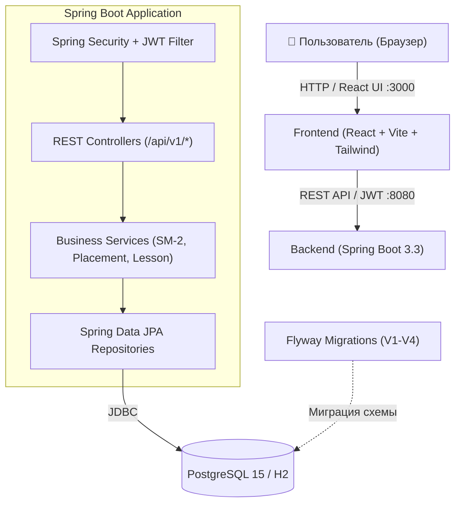

<p align="center">
  
</p>

<p align="center">
  <a href="README.md">Русский</a> | <a href="README.en.md">English</a>
</p>

<p align="center">
  
  
  
  
  
  
  
  
</p>

---

# Lingoreva (LingoPath) 🎓

**Lingoreva** — современная полнофункциональная платформа для изучения английского языка с персонализированной образовательной траекторией, интерактивными практическими модулями, адаптивным входным тестированием и интервальным повторением лексики.

---

## 📑 Содержание

- [Ключевые возможности](#-ключевые-возможности)
- [Технологический стек](#-технологический-стек)
- [Архитектура проекта](#-архитектура-проекта)
- [Структура репозитория](#-структура-репозитория)
- [Быстрый старт](#-быстрый-старт)
  - [Запуск через Docker Compose](#1-запуск-через-docker-compose-рекомендуется)
  - [Локальный запуск (Разработка)](#2-локальный-запуск-для-разработки)
- [Переменные окружения](#-переменные-окружения)
- [API Документация](#-api-документация)
- [Тестирование](#-тестирование)
- [Дорожная карта развития](#-дорожная-карта-развития)

---

## ✨ Ключевые возможности

- 🎯 **Адаптивное входное тестирование (Placement Test)**
  - Определение текущего уровня владения языком по шкале CEFR (от `Pre-A1` до `C2`).
  - Оценка грамматических навыков и лексического запаса с автоматическим выставлением стартового уровня.

- 🧭 **Персонализированный онбординг и цели**
  - Выбор целей обучения: *Everyday communication, Travel English, Work English, IT & Programming, Business English, Interview prep, Academic English, Exam preparation*.
  - Выбор приоритетных навыков: *Vocabulary, Grammar, Reading, Listening, Writing, Speaking, Pronunciation*.
  - Настройка ежедневного лимита времени (10, 20, 30+ минут) и продолжительности курса.

- 📖 **Ежедневные уроки и лаборатория практики (Daily Lessons & Practice Lab)**
  - Теоретические блоки, интерактивные упражнения с мгновенной проверкой и подробными объяснениями ошибок.
  - Пошаговая траектория обучения с автоматической разблокировкой следующих дней.

- 🧠 **Интервальное повторение слов (Spaced Repetition / SM-2)**
  - Механика умных карточек для запоминания слов.
  - Алгоритм расчета интервалов повторения на основе правильности ответов пользователя.
  - Контекстные примеры предложений и озвучивание/транскрипция.

- 🔥 **Геймификация и отслеживание прогресса**
  - Подсчет очков опыта (XP), серий непрерывных занятий (*streaks*).
  - Дашборд с рекомендациями на день и сводной статистикой.

- 🔐 **Безопасность и аутентификация**
  - Stateless-аутентификация на основе JWT токенов.
  - Хэширование паролей с помощью BCrypt.
  - Валидация сложности паролей на клиенте и сервере.

---

## 🛠 Технологический стек

### Backend
- **Язык**: Java 21
- **Фреймворк**: Spring Boot 3.3.4 (Spring Web, Spring Security, Spring Data JPA, Spring Validation)
- **База данных**: PostgreSQL 15 (продакшн / docker), H2 Database (тесты и локальный fallback)
- **Миграции БД**: Flyway
- **Аутентификация**: JJWT 0.12.6
- **Сборка**: Maven

### Frontend
- **Библиотека**: React 18
- **Язык**: TypeScript 5
- **Сборщик**: Vite 5
- **Стилизация**: Tailwind CSS 3.4, PostCSS, Autoprefixer
- **Иконки**: Lucide React
- **HTTP-клиент**: Axios (с перехватчиками для JWT)
- **Роутинг**: React Router DOM v6
- **Тесты**: Vitest, React Testing Library, Jest DOM

### DevOps & Инфраструктура
- Docker, Docker Compose
- Multi-stage скомпонованные Dockerfile для бэкенда и фронтенда

---

## 🏛 Архитектура проекта



---

## 📂 Структура репозитория

```text
LingoPath/
├── icon.jpeg                      # Иконка приложения
├── long.jpeg                      # Баннер проекта
├── tab icon.jpeg                  # Фавиконка
├── README.md                      # Документация на русском
├── README.en.md                   # Документация на английском
└── lingoreva/
    ├── docker-compose.yml         # Запуск полного стека сервисов
    ├── backend/                   # Серверное приложение Spring Boot
    │   ├── Dockerfile
    │   ├── pom.xml                # Зависимости и конфигурация Maven
    │   └── src/
    │       ├── main/
    │       │   ├── java/com/lingoreva/
    │       │   │   ├── config/    # Security, CORS, Exception Handler
    │       │   │   ├── controller/# REST-контроллеры
    │       │   │   ├── dto/       # Запросы и ответы API
    │       │   │   ├── entity/    # JPA-сущности (User, Profile, Word, Lesson...)
    │       │   │   ├── repository/# JPA-репозитории
    │       │   │   ├── security/  # JwtUtil, JwtFilter, CustomUserDetails
    │       │   │   └── service/   # Бизнес-логика
    │       │   └── resources/
    │       │       ├── application.yml
    │       │       └── db/migration/ # Flyway SQL-миграции (V1..V4)
    │       └── test/              # Интеграционные и юнит-тесты
    └── frontend/                  # Клиентское приложение React
        ├── Dockerfile
        ├── package.json           # Зависимости и скрипты Node.js
        ├── vite.config.ts         # Конфигурация Vite и API proxy
        ├── tailwind.config.js     # Конфигурация стилей
        └── src/
            ├── context/           # React Context (AuthContext)
            ├── data/              # Тестовые данные, вопросы и генераторы планов
            ├── pages/             # Экраны (Dashboard, DailyLesson, PlacementTest...)
            ├── services/          # Настройка Axios API
            └── test/              # Тесты компонентов и хуков
```

---

## 🚀 Быстрый старт

### 1. Запуск через Docker Compose (Рекомендуется)

Убедитесь, что у вас установлен [Docker](https://www.docker.com/) и Docker Compose.

```bash
# Перейдите в каталог с сервисами
cd lingoreva

# Запустите все сервисы в фоне
docker-compose up --build -d
```

После старта будут доступны:
- 🌐 **Frontend**: [http://localhost:3000](http://localhost:3000)
- ⚙️ **Backend API**: [http://localhost:8080](http://localhost:8080)
- 🗄️ **PostgreSQL**: `localhost:5432` (пользователь: `postgres`, пароль: `postgres`, база: `lingoreva`)

---

### 2. Локальный запуск для разработки

#### Требования:
- **JDK 21**
- **Node.js 18+** и **npm**
- **Maven 3.9+** (или системный `mvn`)

#### Шаг 1: Запуск базы данных (опционально)
Если вы хотите использовать PostgreSQL вместо встроенной H2:
```bash
cd lingoreva
docker-compose up -d postgres
```
*(По умолчанию бэкенд может автоматически запускаться с локальным файлом базы H2 `./data/lingoreva_db`)*.

#### Шаг 2: Запуск Backend
```bash
cd lingoreva/backend

# Запуск приложения через Maven
mvn spring-boot:run
```
Сервер запустится на порту `8080`.

#### Шаг 3: Запуск Frontend
В отдельном окне терминала:
```bash
cd lingoreva/frontend

# Установка зависимостей
npm install

# Запуск сервера разработки Vite
npm run dev
```
Фронтенд будет доступен по адресу [http://localhost:3000](http://localhost:3000) (с автоматическим проксированием запросов `/api` на бэкенд).

---

## ⚙️ Переменные окружения

### Backend (`lingoreva/backend/src/main/resources/application.yml`)

| Переменная | По умолчанию | Описание |
|------------|--------------|----------|
| `SERVER_PORT` | `8080` | Порт HTTP-сервера бэкенда |
| `DB_URL` | `jdbc:h2:file:./data/lingoreva_db...` | JDBC URL для подключения к БД |
| `DB_DRIVER` | `org.h2.Driver` (или `org.postgresql.Driver`) | Класс драйвера БД |
| `DB_USERNAME` | `sa` (или `postgres`) | Имя пользователя базы данных |
| `DB_PASSWORD` | `sa` (или `postgres`) | Пароль базы данных |
| `JWT_SECRET` | *(64-битный хэш)* | Секретный ключ подписи JWT токенов |

### Frontend (`lingoreva/frontend`)

| Переменная | По умолчанию | Описание |
|------------|--------------|----------|
| `VITE_API_URL` | `http://localhost:8080` | URL бэкенда для проксирования в dev-режиме |

---

## 📡 API Документация

### Основные эндпоинты (`/api/v1`)

| Метод | Эндпоинт | Доступ | Описание |
|---|---|---|---|
| `POST` | `/api/v1/auth/register` | Публичный | Регистрация нового пользователя |
| `POST` | `/api/v1/auth/login` | Публичный | Вход в систему и получение JWT |
| `GET` | `/api/v1/profile` | Авторизован | Получение профиля текущего пользователя |
| `PUT` | `/api/v1/profile` | Авторизован | Обновление настроек, целей и навыков |
| `GET` | `/api/v1/placement` | Авторизован | Получение вопросов для входного теста |
| `POST` | `/api/v1/placement/evaluate` | Авторизован | Отправка ответов теста и расчет CEFR-уровня |
| `GET` | `/api/v1/lessons/trajectory` | Авторизован | Траектория уроков по текущему уровню |
| `GET` | `/api/v1/lessons/next` | Авторизован | Получение следующего доступного урока |
| `POST` | `/api/v1/lessons/complete` | Авторизован | Завершение урока, начисление XP и прогресса |
| `GET` | `/api/v1/vocabulary/review` | Авторизован | Список слов для интервального повторения |
| `POST` | `/api/v1/vocabulary/review` | Авторизован | Отправка результата повторения карточки слова |

Интерактивная документация Swagger доступна по адресу:  
`http://localhost:8080/swagger-ui.html`

---

## 🧪 Тестирование

### Тесты бэкенда (JUnit 5, Mockito, Spring Boot Test)
```bash
cd lingoreva/backend
mvn test
```
> *Примечание для Java 24+ / ранних сборок OpenJDK*: если ByteBuddy сообщает о неподдерживаемой мажорной версии Java, запускайте с ключом:  
> `mvn test -DargLine="-Dnet.bytebuddy.experimental=true"`

### Тесты фронтенда (Vitest, Testing Library)
```bash
cd lingoreva/frontend

# Однократный запуск всех тестов
npm test

# Запуск в режиме наблюдения (watch mode)
npm run test:watch
```

---

## 🗺 Дорожная карта развития

- [x] Авторизация и аутентификация по JWT
- [x] Профиль пользователя, цели, навыки и онбординг
- [x] Входное тестирование с расчетом уровня CEFR
- [x] Алгоритм интервального повторения (SM-2) для карточек слов
- [x] Интерактивные ежедневные уроки и лаборатория практики
- [ ] Голосовой ввод и распознавание произношения (Web Speech API)
- [ ] Интеграция платежной системы (Stripe) для подписок
- [ ] Push-уведомления и напоминания о непрерывных сериях (Streaks)
- [ ] Настройка CI/CD через GitHub Actions

---

## 📄 Лицензия

Проект распространяется под лицензией MIT. Подробности см. в файле [LICENSE](LICENSE) (при наличии).
